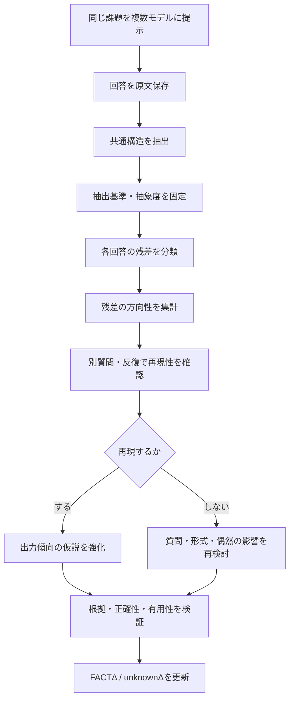

# W1 / Δindex 分析メモ
## 共通構造・残差・LLMの出力傾向に関する客観評価

- 文書種別: 仮説・実験設計メモ
- 状態: 初期分析 / 未検証項目あり
- 対象: Grok・Geminiのエギング回答（GENERALを中心とした比較）
- 目的: 共通構造を基準に、回答に残る差分から再現性のある出力傾向を観測できるか検討する

---

## 1. 要約

異なるLLMの回答から共通部分を抽出し、それを基準として各回答に残る差分（残差）を分析する方法は、検証可能な研究仮説として有望である。

ただし、残差をそのままモデル固有の個性や内部の探知方向とみなすことはできない。現時点で観測できるのは、最終回答に現れた情報の選択・強調・省略・構成上の差分であり、内部の思考過程や差分の原因そのものではない。

基本方針:

> 内部機構を先に推測して特徴を決めるのではなく、出力に繰り返し現れる差分を先に観測し、その差分を説明する仮説を後から作る。

## 2. 現時点で観測できていること

今回の対象は、エギングでアオリイカを釣るための注意点・基本アクション・エギの色やサイズを尋ねたGrokとGeminiの回答である。

### 2.1 共通要素

両方のGENERAL回答には、概ね次の要素が含まれていた。

- キャスト後にエギを沈め、着底を確認する
- シャクリでエギを動かして誘う
- フォール中のアタリに注意する
- ラインの変化やテンションを意識する
- 季節・水質・光量・時間帯などを参考にサイズやカラーを選ぶ
- 反応がなければアクションや色などを調整する

共通構造の暫定表現:

`着底確認 → シャクリ → フォール → 反応確認 → 条件に応じた調整`

これは両回答に現れた説明の共通部分を要約したものであり、エギングの全状況における唯一の正解や、両モデルの内部処理が同じであることを意味しない。

### 2.2 出力上の差分

今回の回答では、説明の重点や構成に違いが見られた。

- Grok: 潮・水深・地形・レンジ変更・ポイント移動など、探索対象を広く説明する傾向が回答上に現れた。
- Gemini: 番号付き手順、ドラグ設定、秒数、季節別サイズ表、条件別カラーなど、操作や分類を整理して提示する構成が現れた。

この違いは今回の回答で観測されたものであり、各モデルに恒常的に備わる性質だと確定したわけではない。

### 2.3 場所情報の有無

提示されたGENERAL回答では、特定の釣り場名や地域固有の情報は確認されなかった。場所・条件を与えた回答では、釣り場、地形、アクセス、安全、製品選定などの具体的な情報カテゴリが追加された例がある。

ただし、場所情報が唯一の原因だったか、追加された現地情報が正確かどうかは、別途検証する必要がある。

## 3. FACTΔと解釈を分ける

「共通部分」をFACTΔとして扱う場合、次の2つを混同しない。

### 3.1 観測事実としてのFACTΔ

例:
- 提示されたGrok回答とGemini回答の両方に、着底・シャクリ・フォールに関する説明がある。
- 両回答には、説明順序や追加項目の差がある。

これらは、対象の回答文を確認することで判定できる限定的な観測事実である。

### 3.2 共通原理としての仮説

例:
- 両モデルが同じ判断原理によって共通構造を生成した。
- 共通構造は、異なる課題でも安定して再現される。
- 残差はモデル内部の探知方向を反映している。

これらは回答文だけからは確定できない。仮説として保持し、追加実験で検証する。

## 4. 共通部分から残差を取り出す

ここでの「残差」は、数学的に確定した誤差ではなく、共通構造を基準にしたときに各回答に残る差分を指す。

暫定用語:

- `BASEΔ`: 比較の基準となる共通構造
- `RESIDUALΔ`: 基準構造に含まれない追加・強調・省略などの差分
- `DIRECTIONΔ`: 複数の課題や反復で繰り返し観測される残差の方向性
- `unknownΔ`: 差分の原因・一般性・意味が未確定の状態

これらの名称は設計候補であり、既存の正式な規範として確定したものではない。

### 4.1 残差の分類候補

1. **追加**: 共通構造にない情報が加わる
2. **強調**: 共通要素のうち特定項目が詳しく扱われる
3. **分岐**: 条件によって提案が分かれる
4. **省略**: ある項目が回答に現れない
5. **具体化**: 一般論が場所・製品・数値・手順などに具体化される
6. **矛盾・不一致**: 共通項や他回答と内容が一致しない
7. **根拠差**: 出典・実測・説明根拠の提示に差がある

「省略」は、回答に記載がないことを意味するにとどまる。「考慮していない」「知らない」とは判定しない。

## 5. 「残差＝個性」という仮説の評価

この仮説は、次の3段階に分ける。

### 段階1: 残差の観測

共通部分を固定し、各回答に残る差分を記録する。

- 状態: 回答文があれば実行可能
- 言えること: 何が追加・強調・省略されたか
- 言えないこと: なぜその差分が生じたか

### 段階2: 出力方向性の検出

異なる質問や反復回答でも、似た種類の残差が繰り返されるかを調べる。

例:
- 地形・環境・リスクに関する情報を繰り返し追加する
- 手順・分類表・具体的な数値を繰り返し追加する

再現性が確認できた場合、「モデルの出力傾向」の候補として記録できる。ただし、質問形式・回答長・指示・生成条件の影響を除外する必要がある。

### 段階3: 内部機構の説明

観測された出力傾向が、モデル内部の探索・判断・生成機構に由来するかを説明する段階。

- 状態: 現在は判定不能
- 注意: 最終回答から内部の思考過程を直接読み取ったと主張しない
- 必要条件: 出力観測だけでは不足する可能性があり、別種の実験・証拠が必要

## 6. 代替説明と交絡要因

今回の共通性や差分は、複数の要因で説明できる。

| 仮説 | 説明 | 現時点の評価 |
|---|---|---|
| H1: 分野の共通知識 | エギングの基本説明が共通している | 有力な説明候補 |
| H2: 質問による誘導 | 質問が注意点・アクション・色・サイズを指定している | 明確な交絡要因 |
| H3: 回答形式の慣習 | 解説回答では手順や条件別分類が使われやすい | 可能性あり |
| H4: モデル間の共通出力傾向 | 異なるモデルでも類似構造が生じる | 検証が必要 |
| H5: 同一の内部探知方向 | 類似した内部探索・判断過程が働く | 現データでは判定不能 |

H1〜H3だけでも今回の観測をある程度説明できる。よって、H4やH5を早期に結論づけず、既知の説明で説明できる範囲と、説明しきれずに残る範囲を切り分ける。

## 7. 現在の設計上の課題

### 課題A: 共通部分の抽出者による偏り

抽出者が何を「共通」と呼ぶかによって結果が変わる。

**対策:** 共通構造を複数の抽象度で記録する。

- L1: 着底・シャクリ・フォールなどの具体的操作
- L2: 誘う・観察する・条件を変えるなどの機能
- L3: 観察と調整を繰り返すという抽象構造

抽象度を明示し、異なる階層を同じ項目として扱わない。

### 課題B: 回答長・形式の影響

長い回答ほど残差が多く見えやすい。表形式は分類項目を明示しやすく、文章形式は別の特徴を強調する可能性がある。

**対策:** 回答形式と長さをそろえた条件と、自由形式の条件を分けて比較する。

### 課題C: 反復性・一般性が未検証

少数の回答だけでは、モデルの恒常的な特徴とは言えない。

**対策:** 同じモデル・同じ条件で複数回試し、さらに異なる課題群でも再現性を確認する。

### 課題D: 省略の誤読

記載されていない情報を、モデルが考慮していないと誤認する危険がある。

**対策:** 「記載なし」と「考慮していない」を分離する。前者は出力から観測可能だが、後者は追加検証なしでは判定しない。

### 課題E: 追加情報の正確性

具体的な場所・地形・アクセス・製品情報が増えても、正確性が高いとは限らない。

**対策:** 「追加情報量」と「裏付けの強さ」を別軸で評価する。主張ごとに出典、確認状態、未確認状態を記録する。

### 課題F: 共通部分が適切な基準とは限らない

2つの回答の共通項が、重要な構造をすべて表すとは限らない。共通しているだけで重要性や正確性が保証されるわけでもない。

**対策:** 共通性、正確性、重要性、有用性を別々の評価項目にする。

## 8. 推奨する検証実験

| 実験 | 変える要素 | 主な目的 |
|---|---|---|
| E1: 同一条件反復 | 同じモデル・同じ質問を複数回 | 出力の変動幅を測る |
| E2: モデル間比較 | 同じ質問を複数モデルに提示 | モデル間の残差を比較 |
| E3: 質問形式比較 | 同じ目的で質問の形式を変える | 質問文の影響を調べる |
| E4: 文脈比較 | 新規チャットと既存チャットを比較 | 会話履歴の影響を調べる |
| E5: 形式統一比較 | 長さ・見出し・表の指定を統一 | 表現形式の交絡を減らす |
| E6: 異分野比較 | 釣り以外の課題でも同じ分析を行う | 残差の方向性が一般化するか調べる |

推奨順序は、まずE1とE2で基礎データを作り、その後E3〜E5で交絡要因を調べ、最後にE6で一般性を検討する。

### 検証フロー

## 9. Δindexへの暫定登録案

| ID | 内容 | 状態 |
|---|---|---|
| FACTΔ-OBS-01 | 提示されたGrokとGeminiのGENERAL回答に共通要素がある | 対象回答内で観測済み |
| FACTΔ-OBS-02 | 提示された両回答には説明範囲・構成上の差分がある | 対象回答内で観測済み |
| unknownΔ-HYP-01 | 共通構造との差分にモデルの出力傾向が反映される | 仮説 |
| unknownΔ-HYP-02 | 残差の反復パターンからモデルの探知方向を分類できる | 仮説 |
| unknownΔ-HYP-03 | 残差の方向性が内部機構を反映している | 未検証・判定不能 |
| unknownΔ-HYP-04 | 共通構造が異なる質問・条件でも安定して再現される | 未検証 |

「観測済み」は、今回提供された回答文内で確認できるという限定的な意味である。釣りの知識の正しさ、一般的なモデル特性、内部機構の説明が実証されたという意味ではない。

FACTΔの正式な昇格基準が別途定義されている場合は、その基準に従い、上記の登録案を自動的に正式FACTへ昇格させない。

## 10. 総合評価

- **方法の有望性:** 高い。共通構造を基準に差分を整理することで、回答間の比較がしやすくなる。
- **現時点の実証度:** 限定的。少数の回答から安定したモデル特性までは確定できない。
- **内部機構への説明力:** 未確定。出力上の方向性と内部機構を結びつける証拠はない。
- **W1との適合性:** 高い。観測事実と推測を分け、回答の差分を追跡できる。
- **最優先課題:** 残差の定義・抽象度・分類基準を固定し、反復性と別課題での再現性を検証する。

### 最終結論

「共通部分を固定し、はみ出した部分を観測する」という考え方は、LLMの回答傾向を調べるための実用的な比較方法になり得る。

ただし、現時点で言えるのは、共通構造と出力上の差分が観測できるということまでである。差分がモデル固有の個性を示すのか、質問・回答形式・分野知識の影響なのか、さらに内部機構を反映するのかは、段階的な検証が必要となる。

**内部を先に説明するのではなく、出力に繰り返し現れる差分を先に見つけ、その差分を説明する仮説を後から作る。**

この順序を守ることが、W1とΔindexを接続するうえでの重要な設計原則となる。
